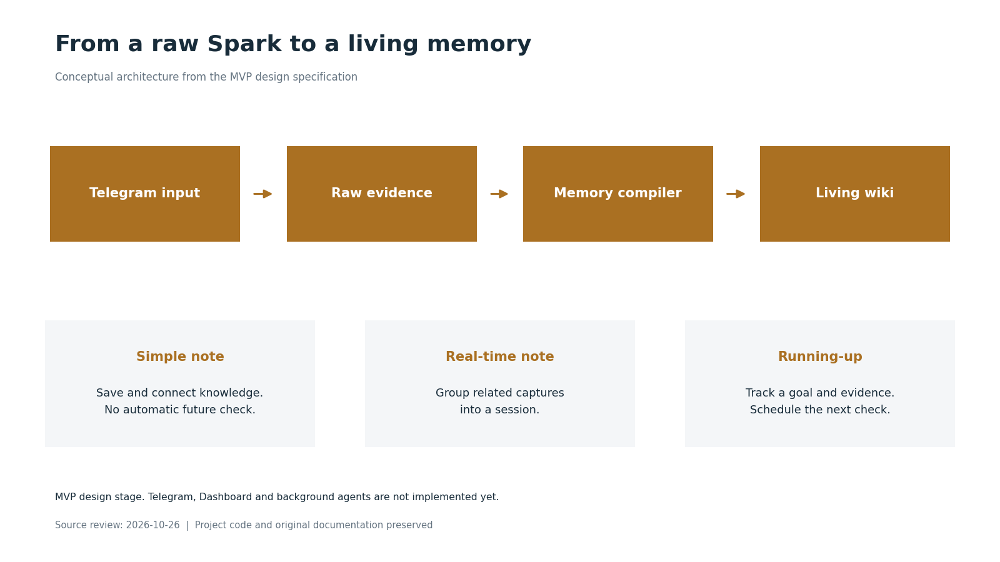
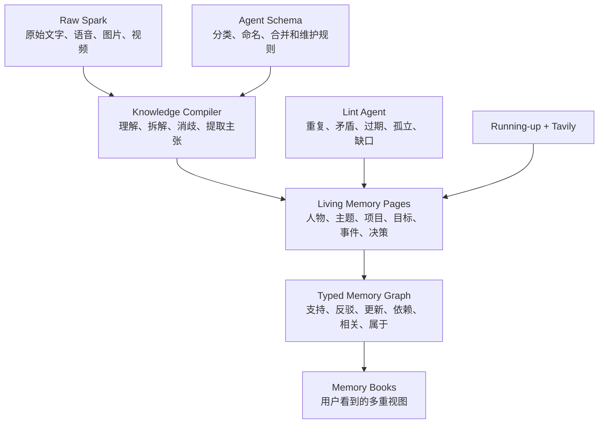
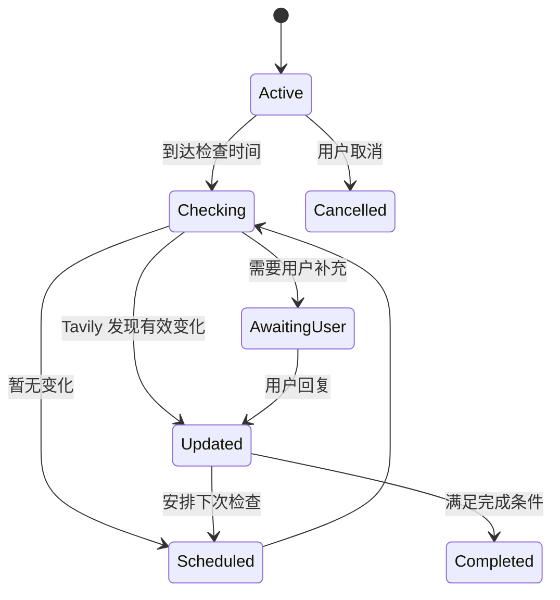
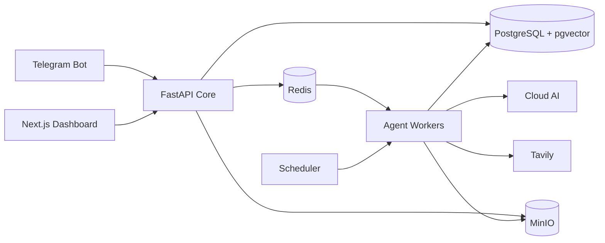

# Spark Memory

> 先捕捉，再整理。让 Agent 帮你连接、维护和跟进记忆。

Spark Memory 是一个正在设计和开发中的 **Agent 驱动多模态笔记本**。它面向不愿在记录灵感前先分类的人：用户只管把转瞬即逝的想法发进来，系统负责在之后理解内容、建立关联、更新长期知识，并主动跟进需要持续关注的事项。

**English summary:** Spark Memory is an Agent-driven, multimodal notebook that captures unstructured thoughts first and organizes them afterward. It turns an ongoing stream of text, voice, handwriting, images, and video into a source-backed, evolving personal knowledge system with intelligent follow-up.

## 项目状态

> [!IMPORTANT]
> 当前仓库处于 **MVP 设计阶段**。产品规格已经完成，应用代码尚未开始实现，因此现在还不能安装或运行。

- 已完成：产品边界、系统架构、长期记忆模型、Agent 工作流、Dashboard 信息架构、安全方案和验收标准
- 下一步：制定实施计划，并按可验证的垂直切片开发 MVP
- 完整规格：[Spark Memory MVP Design](docs/superpowers/specs/2026-07-14-spark-memory-mvp-design.md)

## 设计图：从原始输入到长期记忆

**概念流程图，非运行界面。** 当前仓库只有设计与规格，没有已经可以安装的应用；图中 Telegram、编译器、Wiki 和 Running-up 都是拟实现的模块。

[查看全部图片与来源](docs/assets/showcase/README.md)

## 为什么做 Spark Memory

大多数笔记工具要求用户在记录前决定文件夹、标签或任务类型。但真正的灵感往往是发散的、跨领域的，而且稍纵即逝。分类本身可能打断思考；记录完成后，笔记又经常停留在原处，不会主动更新、互相勾稽或提醒用户继续推进。

Spark Memory 希望解决四个问题：

1. **记录前不分类**：Agent 在捕捉后判断内容类型和归属规则。
2. **笔记会持续生长**：新输入可以更新既有知识页面、关系和结论。
3. **跟进不只是提醒**：Running-up Agent 能根据目标、证据和状态决定下一步。
4. **输入不限于键盘**：支持文字、语音、手写图片、文档和视频。

## MVP 体验

### Telegram：低摩擦捕捉入口

用户可以直接向 Bot 发送：

- 普通文字和自然语言命令
- 语音或音频
- 手写笔记照片和一般图片
- 文档
- 视频

Bot 会先可靠保存原始内容，再在后台转写、识别、理解和整理。用户不需要预先选择笔记类型或记忆本。

### Dashboard：记忆工作台

Dashboard 采用三栏式记忆工作台：

- 左侧：今天、所有记忆、Running-up、定时任务、Review 和记忆本
- 中间：按时间展示 Spark、实时笔记和知识页面更新
- 右侧：详细内容、原始来源、关联记忆、Agent 解释和版本历史

用户可以搜索、编辑、合并、拆分、归档、恢复、重新分类，以及撤销 Agent 的修改。

## 三种笔记行为

| 类型 | 系统行为 |
| --- | --- |
| 简单笔记 | 保存、理解、关联并编译进长期知识，不主动安排未来检查。 |
| 实时笔记 | 根据时间、语义和回复关系自动聚合连续输入，结束后统一整理。 |
| Running-up | 建立目标、完成条件和下一次检查时间，通过用户追问或联网搜索持续推进。 |

普通定时任务与 Running-up 分开：前者按确定时间提醒，后者根据变化和证据动态决定下一步。

## 长期记忆：从 RAG 到持续编译的 Wiki

Spark Memory 参考了 Andrej Karpathy 的 [LLM Wiki](https://gist.github.com/karpathy/442a6bf555914893e9891c11519de94f) 思路：不让模型在每次提问时从零检索和拼接全部原始材料，而是让 Agent 持续维护一个可阅读、可追溯、会累积的知识库。

核心原则：

- 原始输入不可变，Agent 生成的内容可以演化但必须保留版本
- 一条笔记可以同时属于多个记忆本
- 结论、关系和联网更新都要记录来源、时间和置信度
- 新信息与旧信息冲突时保留两种主张，而不是静默覆盖
- 有价值的查询结果可以反写为长期知识，普通闲聊不会污染知识库
- 定期 Lint 会发现重复、矛盾、过期事实、孤立页面和缺失关联

## Running-up 与 Tavily

Running-up 是持久状态机，而不是一条固定提醒。每个项目都保存目标、完成条件、当前状态、证据、下次检查时间和搜索预算。

Tavily 搜索结果会保存 URL、检索时间和所支持的具体主张。系统会进行结果去重、预算控制和失败退避，不会无限搜索。

## MVP 技术架构

- Next.js：Dashboard
- FastAPI/Python：业务 API、Telegram Webhook 和 Agent 服务
- PostgreSQL + pgvector：结构化数据、全文与语义检索、版本和图关系
- Redis + Worker：后台任务、锁、重试和调度协调
- MinIO：原始语音、图片、视频和文档
- Tavily：需要外部新信息的跟进和事实更新
- Docker Compose：单台云服务器上的 MVP 部署

MVP 先使用 PostgreSQL 的边表和递归查询处理图关系，不提前引入 Neo4j。达到更大规模并出现明确瓶颈后再评估专用图数据库。

## Settings 与 BYOK

第一阶段只有一个预置账户，但 Dashboard 会保留 Settings 入口。用户可以管理：

- Telegram Bot Token
- 云端模型 API Key
- Tavily API Key
- 账户时区

Key 会在服务端加密保存，浏览器只能看到掩码。后续版本将开放注册，让每个用户绑定自己的 Bot 和 API Key，形成多租户 BYOK 模式。

> [!WARNING]
> 不要把 `.env`、Bot Token、模型 Key、Tavily Key、数据库备份或个人记忆内容提交到 Git。仓库已通过 `.gitignore` 排除常见本地密钥和数据目录。

## 计划路线

- [x] 产品需求与 MVP 范围
- [x] 系统与数据架构
- [x] Karpathy LLM Wiki + 时态知识图谱设计
- [x] Telegram、Dashboard 和 Running-up 工作流
- [x] 安全、备份和验收标准
- [ ] 实施计划与任务拆分
- [ ] 基础设施和数据模型
- [ ] Telegram 文字捕捉垂直切片
- [ ] 多模态处理
- [ ] Dashboard 记忆工作台
- [ ] Running-up + Tavily
- [ ] 部署、备份和故障验证

## 参与讨论

如果你也在探索 Agent 笔记、个人知识库、LLM Wiki、GraphRAG 或长期记忆系统，欢迎通过 GitHub Issues 分享使用场景、设计反馈或实现建议。

## License

本仓库目前尚未添加开源许可证。在 `LICENSE` 文件加入之前，仓库内容仅供查看与讨论，保留所有权利。

## 更多项目

[A800 动量回测](https://github.com/wongzijie/stock_database) · [OpenClaw 编排经验](https://github.com/wongzijie/OpenClaw-Experience) · [Snapshot 截图工具](https://github.com/wongzijie/Snapshot) · [Buffett Archive 本地检索](https://github.com/wongzijie/buffett-archive) · [相册快送](https://github.com/wongzijie/album-send)
