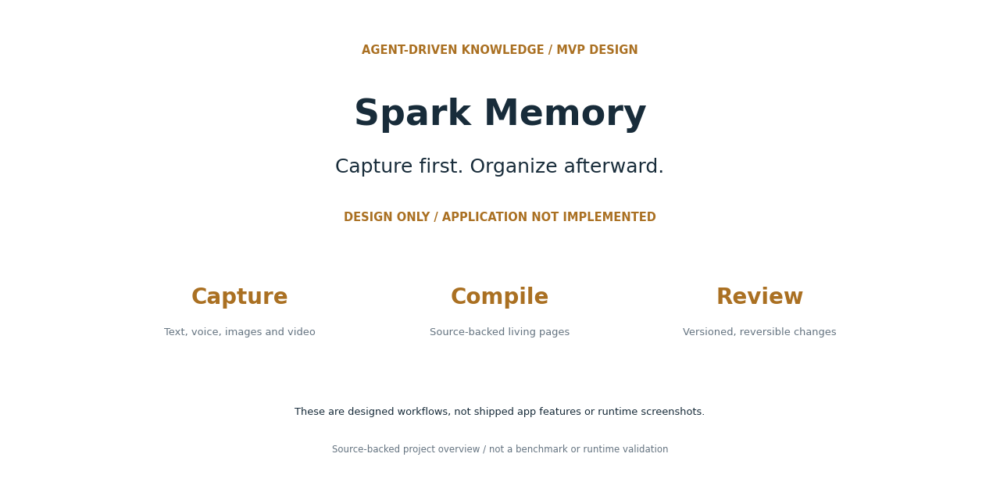

# Spark Memory 图文素材

状态：**DESIGN ONLY / APPLICATION NOT IMPLEMENTED**。这些图片根据现有源码或文档制作，流程图属于说明图，并非运行截图；本次没有重新验证应用运行或外部服务。

## 项目封面

[查看原图](cover.png)

## 工作流程与边界

[查看原图](workflow.png)

## 社交分享封面

[查看原图](social-preview.png)

## 图中信息依据

- [README.md](https://github.com/wongzijie/spark-memory/blob/ec5bba4685105da18e2b5c22a6c859ed0f50ae96/README.md)
- [docs/superpowers/specs/2026-07-14-spark-memory-mvp-design.md](https://github.com/wongzijie/spark-memory/blob/ec5bba4685105da18e2b5c22a6c859ed0f50ae96/docs/superpowers/specs/2026-07-14-spark-memory-mvp-design.md)

图片指纹及来源版本见 [manifest.json](manifest.json)。
